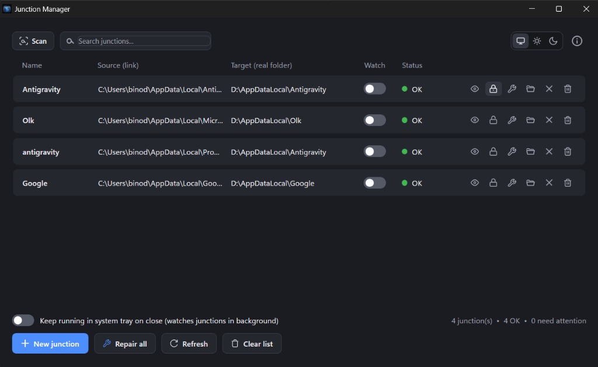
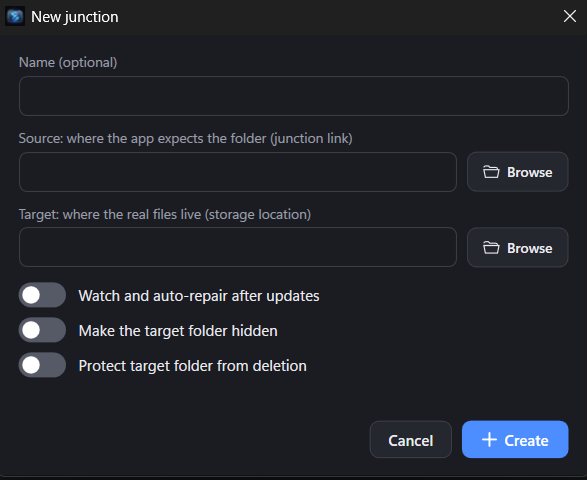
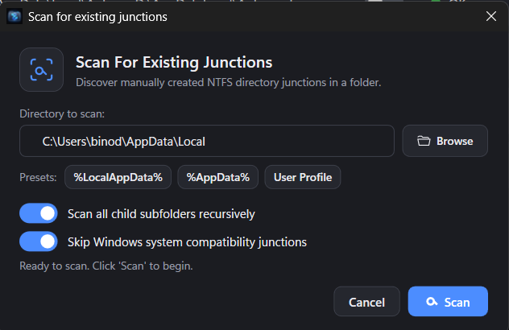
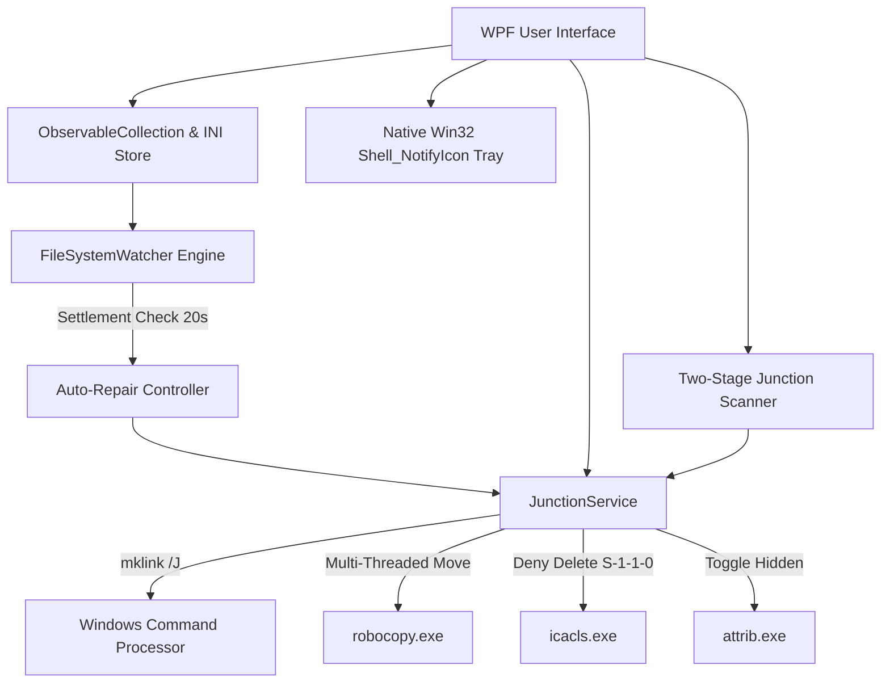

<p align="center">
  
</p>

<h1 align="center">Windows Junction Manager</h1>

<p align="center">
  <strong>A lightweight, modern, and high-performance NTFS directory junction manager for Windows.</strong>
</p>

<p align="center">
  <a href="https://github.com/binodkhandual/Windows-Junction-Manager/releases"></a>
  <a href="https://dotnet.microsoft.com/download/dotnet/8.0"></a>
  
  
  
  <a href="LICENSE"></a>
</p>

<p align="center">
  <a href="#overview">Overview</a> •
  <a href="#screenshots">Screenshots</a> •
  <a href="#key-features">Key Features</a> •
  <a href="#why-ntfs-junctions">Why NTFS Junctions?</a> •
  <a href="#installation--download">Installation</a> •
  <a href="#automated-releases--build-script">Automated Releases</a> •
  <a href="#user-guide">User Guide</a> •
  <a href="#technical-architecture">Technical Architecture</a> •
  <a href="#building-from-source">Building from Source</a> •
  <a href="#faq">FAQ</a>
</p>

---

## Overview

Are your high-speed SSDs or primary `C:` system drive running out of space due to bloated folders like `%LocalAppData%`, game caches, developer runtimes (`.nuget`, `.gradle`, `node_modules`, `vcpkg`, AI model weights), or application data? 

Many Windows applications hardcode their storage paths to the system drive and offer no setting to relocate their data.

**Windows Junction Manager** solves this transparently. It allows you to relocate heavy directories to a secondary drive (e.g. `D:`, `E:`) and establishes native **NTFS directory junctions**. Windows and all your applications continue accessing their original paths with zero performance overhead, completely unaware that the physical files reside on another drive.

Unlike clumsy command-line tools or legacy utilities, Windows Junction Manager provides an intuitive, high-speed WPF interface with integrated data migration, background auto-repair, and deletion protection.

---

## Screenshots

<p align="center">
  
  <br>
  <em><strong>Main Dashboard:</strong> Tracked directory junctions with real-time health status, inline action pills (stealth, delete lock, repair, open, untrack, remove), instant search filter, and summary counters.</em>
</p>

<br>

<p align="center">
  
  &nbsp;&nbsp;
  
</p>

<p align="center">
  <em><strong>Left:</strong> Create a new junction with automatic Robocopy data migration, background auto-repair, stealth mode, and deletion protection.<br>
  <strong>Right:</strong> Discover existing junctions with path presets, recursive scan, and Windows legacy junction filtering.</em>
</p>

---

## Key Features

### 🚀 Built-In Multi-Threaded Robocopy Migration
- When linking an existing directory, Junction Manager automatically moves all files and folders to your target storage destination using Windows' native multi-threaded `robocopy`.
- **Live Progress Card**: Displays completed files, total file count, megabytes transferred, real-time throughput rate (`MB/s`), animated progress bar, and dynamic estimated time remaining (`ETA`).

### 🔍 Two-Stage Deep Junction Scanner
- **One-Click Folder Discovery**: Scan any folder (e.g. `%LocalAppData%`, `%AppData%`, user profiles, or custom directories) to find existing junctions created manually or by other tools.
- **System Compatibility Filter**: Automatically filters out legacy Windows backward-compatibility junctions (such as `Application Data`, `Cookies`, `History`, `NetHood`, `Temporary Internet Files`, `Content.IE5`) so you only manage actual user data.
- **Selective Checklist Dialog**: Preview all discovered junctions in a dedicated results window with a master toggle header checkbox and import only the entries you choose.

### 🛡️ Target Folder Data Protection & Stealth
- **ACL Protection (`icacls`)**: Toggle deletion protection on your real target storage folder with a single click. Adds an explicit `*S-1-1-0:(DE)` (Deny Delete) Access Control Entry to prevent accidental deletion of your valuable data.
- **Stealth Mode (`attrib +h`)**: Clean up your target drive in File Explorer by toggling the hidden attribute on target folders.

### ⚡ Continuous Auto-Repair File Watcher
- Many modern apps (browsers, Electron applications, game launchers) frequently recreate their folder structure during updates, breaking or wiping out junction links.
- Junction Manager includes an intelligent background `FileSystemWatcher` engine.
- Features a **20-second debounce and write-settle safety check** to ensure installers finish writing before automatically restoring the junction and merging files.

### 🪟 Windows System Tray Minimization
- Check **"Keep running in system tray on close"** to minimize the app to the notification area instead of exiting.
- Provides balloon notifications on background status changes and keeps your monitored junctions auto-repaired silently.
- Quick tray context menu to open the window or terminate the application.

### 🔎 Instant Real-Time Search Filtering
- Live search bar in the top navigation header instantly filters items by name, source path, or target path.
- Press `Esc` or click the clear button to reset the search instantly.
- Dynamic summary counters update in real time (`X of Y shown • Z OK`).

### 🌓 Dynamic Theming & Windows Titlebar Integration
- Live switcher supporting **System Default**, **Dark Theme**, and **Light Theme**.
- Integrates with Windows Desktop Window Manager (`dwmapi.dll`) for seamless native titlebar dark mode.
- Non-intrusive in-app floating toast notifications for user actions, repairs, and status updates.

### ❌ Safe Untrack vs. Disk Deletion
- **Untrack (`×`)**: Removes the entry from Junction Manager and the configuration file while leaving both the junction link and physical files on disk 100% intact.
- **Delete Junction (`🗑️`)**: Safely removes the NTFS directory junction pointer from Windows without touching any of the actual files residing in your storage directory.

### 🪶 Native & Lightweight
- Built with **C# and .NET 8 WPF**.
- Compiles into a single-file executable **under 1 MB**.
- Zero runtime bloat, minimal memory footprint, and instant startup.

---

## Why NTFS Junctions?

Windows supports several link types. Here is how NTFS Junctions compare:

| Feature | NTFS Directory Junction (`mklink /J`) | Symbolic Link (`mklink /D`) | Hard Link (`mklink /H`) |
| :--- | :---: | :---: | :---: |
| **Requires Developer Mode / Admin Privileges** | ❌ **No** (Standard User) | ⚠️ Yes (Unless Dev Mode active) | ❌ No |
| **Works Across Local Drives (`C:` to `D:`)** | ✅ **Yes** | ✅ Yes | ❌ No (Single partition only) |
| **Targets Directories** | ✅ **Yes** | ✅ Yes | ❌ No (Files only) |
| **Transparent to Win32 / Legacy Applications** | ✅ **Yes** (Native reparse point) | ⚠️ Sometimes causes app errors | ✅ Yes |
| **Network / Remote Volume Support** | ❌ Local drives only | ✅ Yes | ❌ No |

> [!TIP]
> **NTFS Junctions** are the gold standard on Windows for redirecting local storage. Because they are implemented at the filesystem level as reparse points, every program, game, and system service sees the original folder path seamlessly.

---

## Installation & Download

### Pre-Built Binary
1. Download the latest `JunctionManager.exe` from the [Releases](https://github.com/binodkhandual/Windows-Junction-Manager/releases) page.
2. Place `JunctionManager.exe` anywhere (e.g. `C:\Program Files\JunctionManager\` or your portable tools folder).
3. Run the executable. No installer required!

### Requirements
- **Operating System**: Windows 10 (version 1809 or higher) or Windows 11 (64-bit).
- **Filesystem**: NTFS on both source and target volumes (Junctions are an NTFS feature).
- **Runtime**: [.NET 8 Desktop Runtime](https://dotnet.microsoft.com/download/dotnet/8.0/runtime) (if using the framework-dependent build).

### Configuration Storage
All your junction entries and settings are stored locally in an INI file:
```text
%LocalAppData%\JunctionManager\junctions.ini
```
Settings are preserved across application updates and portable moves.

---

## Automated Releases & Build Script

### 🛠️ One-Click Release Builder (`build-release.bat`)
We include a dedicated release automation script (`build-release.bat` for Windows and `build-release.sh` for Bash/WSL):

```cmd
build-release.bat
```
*(You can also pass a version directly: `build-release.bat 2.1.0`)*

**What the script does automatically:**
1. **Version Detection & Bumping**: Reads `<Version>` from `JunctionManager.csproj` or accepts your new version and automatically updates both `.csproj` and `AboutWindow.xaml`.
2. **Native Single-File Compilation**: Publishes an optimized x64 native single-file Windows executable into `dist/`.
3. **Appends Version to Executable**: Generates both:
   - `dist\JunctionManager.exe` (standard name)
   - `dist\JunctionManager-v<version>-win-x64.exe` (version appended)
4. **Automated GitHub Release Creation**:
   - Prompts to commit changes, create the git tag `v<version>`, and push it to GitHub origin.
   - The included **GitHub Actions workflow** (`.github/workflows/release.yml`) immediately detects the new tag, builds the project on GitHub's cloud runners, and automatically publishes the release with downloadable executables at:
     `https://github.com/binodkhandual/Windows-Junction-Manager/releases`
   - If the [GitHub CLI (`gh`)](https://cli.github.com/) is installed locally, it can also create the GitHub release directly from your terminal.

---

## User Guide

### 1. Creating a New Junction
1. Click **New junction** (or press the green `+` button).
2. Enter a friendly **Name** (optional, defaults to the folder name).
3. Select the **Source** folder (where the app expects files to be, e.g. `C:\Users\You\AppData\Local\HeavyApp`).
4. Select the **Target** folder (where the real files will live, e.g. `D:\Storage\AppData\HeavyApp`).
5. Choose your options:
   - **Watch and auto-repair after updates**: Continuously monitor parent directory and relink if overwritten.
   - **Make the target folder hidden**: Hides the storage folder in File Explorer.
   - **Protect target folder from deletion**: Adds ACL deny-delete rules.
6. Click **Create**. If the source directory contains files, Junction Manager will automatically migrate them via Robocopy with real-time progress before establishing the junction.

### 2. Scanning for Existing Junctions
1. Click the **Scan** button in the top toolbar.
2. Select or paste a directory path, or use one of the quick presets (`%LocalAppData%`, `%AppData%`, or `User Profile`).
3. Leave **Skip Windows system compatibility junctions** checked to automatically omit legacy OS links.
4. Click **Scan**.
5. In the **Discovered Junctions** dialog, select the junctions you wish to manage and click **Import Selected**.

### 3. Monitoring & Status Indicators
Each entry in the main list displays a status indicator:
- 🟢 **OK**: The junction is healthy, active, and points to the target directory.
- 🟡 **Unlinked**: The source path exists as a standard folder (e.g. replaced by an app update). Click **Repair** to migrate new files and restore the junction.
- 🟡 **Wrong target**: The junction exists but points to a different destination than configured.
- 🔴 **Link missing**: The source link does not exist.
- 🔴 **Target missing**: The target storage folder cannot be found (e.g. external drive disconnected).

---

## Technical Architecture

Windows Junction Manager is crafted for maximum speed and reliability:



- **Native Win32 P/Invoke**: Directly interfaces with `shell32.dll`, `user32.dll`, and `dwmapi.dll` for smooth tray notifications, context menus, and DWM window attributes without bulky third-party dependencies.
- **Robust Robocopy Integration**: Uses `/E /MOVE /IS /IT /R:1 /W:1` with standard output stream parsing for real-time progress tracking, error detection, and safe folder cleanup.
- **Low-Overhead INI Storage**: Persists data in a clean, human-readable INI structure with atomic write safety.

---

## Building from Source

### Prerequisites
- [Git](https://git-scm.com/)
- [.NET 8.0 SDK](https://dotnet.microsoft.com/download/dotnet/8.0)
- Visual Studio 2022 (with .NET desktop development workload) or VS Code

### Steps

1. **Clone the repository**:
   ```bash
   git clone https://github.com/binodkhandual/Windows-Junction-Manager.git
   cd Windows-Junction-Manager
   ```

2. **Build the solution**:
   ```bash
   dotnet build JunctionManagerWpf/JunctionManager.csproj -c Release
   ```

3. **Publish as a Single-File Native Executable**:
   ```bash
   dotnet publish JunctionManagerWpf/JunctionManager.csproj -c Release -r win-x64 -p:PublishSingleFile=true --self-contained false -o JunctionManagerWpf/dist
   ```
   The compiled single-file `JunctionManager.exe` (< 1 MB) will be generated in `JunctionManagerWpf/dist/`.

---

## Configuration File Schema

The configuration file at `%LocalAppData%\JunctionManager\junctions.ini` follows standard INI structure:

```ini
[Settings]
Theme=System
MinimizeToTray=1

[Junction1]
Name=Spotify Cache
Source=C:\Users\Username\AppData\Local\Spotify\Storage
Target=D:\Junctions\Spotify\Storage
Hidden=0
Protected=1
Watch=1
```

---

## FAQ

#### Can I create junctions pointing to a network share (NAS / SMB)?
No. By design, NTFS directory junctions only work between local drives formatted with NTFS on the same physical system. For network paths, use symbolic links or network shares.

#### Does removing a junction delete my target files?
**No.** Removing a junction link (or clicking untrack) removes the junction pointer in Windows or deletes the listing in the app. Your original data files in the target storage directory remain completely untouched.

#### Do I need to run as Administrator?
For standard user folders (such as `%LocalAppData%`, user documents, or secondary drives), Administrator privileges are **not** required. You only need elevated rights if you are redirecting protected system folders (e.g. `C:\Program Files`, `C:\Windows`) or modifying permissions in restricted directories.

#### What happens if my target drive is unplugged or unavailable?
If the target drive is disconnected, the junction status will display 🔴 **Target missing**. Reconnecting the drive will immediately restore normal access upon refresh.

---

## Contributing

Contributions, bug reports, and feature suggestions are welcome!

1. Fork the Project
2. Create your Feature Branch (`git checkout -b feature/AmazingFeature`)
3. Commit your Changes (`git commit -m 'Add some AmazingFeature'`)
4. Push to the Branch (`git push origin feature/AmazingFeature`)
5. Open a Pull Request

---

## License

Distributed under the **MIT License**. See `LICENSE` for more information.

---

## Author & Acknowledgments

- **Author**: ([Binod Khandual](https://github.com/binodkhandual))
- Thanks to biN32 for inspiring this project.
- Built with modern C# and .NET 8 WPF.
